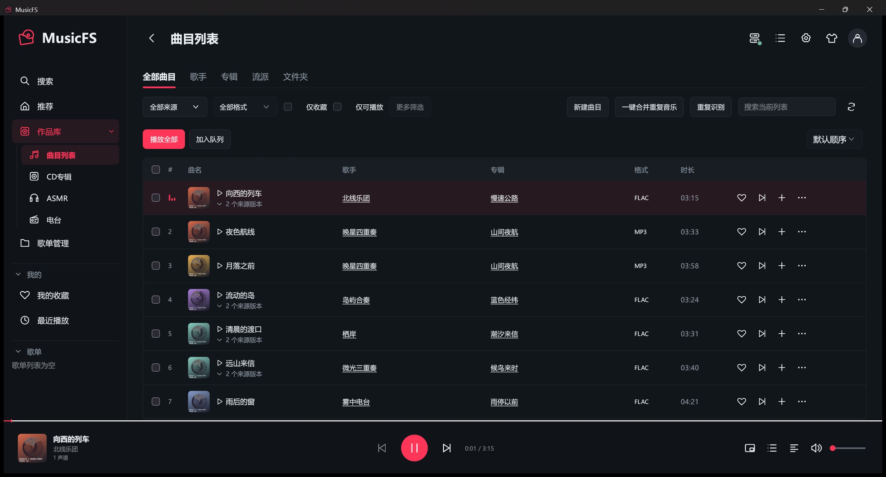

# MusicFS 桌面客户端

简体中文 · [English](docs/README.en.md)

MusicFS 桌面播放器连接已有的 MusicFS Server。窗口、界面、服务端连接和音频播放均使用 Rust。egui/eframe 绘制原生窗口，界面沿用 Web 的侧栏、曲库和底部播放栏。[查看当前开发版本](VERSION)。



## 使用

1. 启动已有的 MusicFS Server。在桌面端输入服务端地址和管理员提供的登录令牌。本机默认地址为 `http://127.0.0.1:8080`，远程连接使用 HTTPS。首次登录默认只在本次会话有效；勾选「在此设备上保持登录」后，客户端将登录凭据保存到系统凭据库，重启时自动连接原实例。退出登录会清除已保存的登录。[登录窗口](docs/screenshots/windows-remember-login.png)
2. 已有曲库可以直接播放。要导入音乐，请用管理员账号打开「设置 → 音乐源」，从服务端允许访问的目录中添加音乐目录，查看扫描进度和曲目统计。远程连接时选择的是服务端上的目录。
3. 在「作品库 → 曲目列表」的「全部曲目」中搜索所有来源的曲目。切换到歌手、专辑、流派或文件夹时，可以按来源筛选。双击曲目开始播放。底部播放栏可切歌、调节音量、打开队列、迷你播放器和桌面歌词。支持字节范围定位的音频可以拖动进度条。

Windows 下，将鼠标停在任务栏的 MusicFS 图标上，可在窗口预览下方切换上一首、播放或暂停、切换下一首。右键点击任务栏或通知区域的 MusicFS 图标，可显示主窗口、控制播放或退出。macOS 使用菜单栏图标，Linux 在支持 StatusNotifierItem 的桌面显示托盘菜单。系统媒体控件会显示当前曲目的信息和封面，可在主窗口最小化时控制播放。

## 曲库与设置

- **曲目与来源版本。** 曲目可以包含多个音源。在「来源版本」中可试听、指定默认来源，或把收藏和歌单条目固定到某个版本。自动选择的条目在以后播放时跟随默认来源。文件夹中的文件则按它自身的来源播放。
- **整理曲库。** 重复识别可生成候选，支持人工比对、关联、排除及批量合并。同一专辑内也可合并曲目，指定主曲目，逐项决定保留的标题、别名、艺人、流派、年份、评分与封面。
- **作品库与搜索。** 在 CD 专辑、ASMR 或电台页面点开作品卡片，可查看创作者、标签、本地副本和音轨。侧栏的「搜索」支持按曲目、歌手或专辑查看结果。按 Ctrl+K 可直接进入搜索框。
- **歌单管理。** 在「本地歌单」新建歌单、编辑名称和曲目来源，或组合其他歌单后发布快照。在「平台歌单」选择来源，可以浏览账号下的歌单，或输入歌单编号预览并导入。支持写入的平台歌单还可关联到本地歌单或「我的收藏」。「已导入」显示绑定账号与同步状态，可手动重新同步。
- **推荐。** 推荐页按来源展示歌单及封面，支持刷新和回看历史。登录网易云后，可在当前推荐中打开「每日推荐歌曲」。
- **音乐源与插件。** 管理员可配置本地目录的导入规则、监听和专辑刮削顺序，以及服务端插件与实例。在线来源按插件能力提供账号状态、扫码登录或匿名检索。Apple Music 授权会在系统浏览器打开同一服务端的 MusicFS Web，需在浏览器登录同一 MusicFS 账号。
- **播放队列。** 点底部播放栏的队列图标，在右下角查看曲目。标题栏显示总数，并提供清空、固定和关闭操作。固定后可从原位拖动无边框窗口，拖到主窗口边缘松手即可吸附，再拖远就会脱离。取消固定会回到弹层，关闭后下次也从弹层打开。
- **播放顺序。** 点底部播放栏右侧的播放顺序图标，或打开「设置 → 播放配置」。默认顺序播到队尾停止。单曲循环会在曲终重播当前曲目，列表循环会从队尾回到队首，随机循环会打乱每一轮的播放顺序。重启后保留所选模式。
- **播放与音效。** 本机播放 MP3、FLAC 和 WAV。可设置音量、自动音量平衡，以及切歌、暂停和跳转各自的淡出淡入时长。在「设置 → 音效与输出」中可切换系统默认设备或指定输出设备，按设备能力选择声道布局。可调整 DSP 缓冲区大小，也可试听、排序和保存增益、十段均衡、参数均衡、动态压缩和混响。[音频处理说明](docs/audio-processing.md)
- **外观与语言。** 可选内置主题，并跟随系统语言或指定简体中文、繁體中文、English、日本語。歌词窗口显示服务端为当前音源选择的歌词。关闭辅助窗口后主窗口可继续播放。

在侧栏的「歌单」中可直接打开已登录账号自建或收藏的歌单。在歌单和「我的收藏」中，排序左侧的搜索框可按曲名、歌手或专辑查找整份列表。

曲库专辑详情里的「更新封面」会让服务端重新下载第三方图片。平时浏览使用服务端保存的封面。

## 从源码运行

安装 Rust（rustup 将读取 [rust-toolchain.toml](rust-toolchain.toml)）。Windows 构建使用 Visual Studio 的 MSVC 工具链和 Windows SDK。Linux 需要 X11/Wayland、OpenGL、ALSA 和 D-Bus 开发库、pkg-config 及 CJK 字体；保存登录还需要可用的 Secret Service。

```sh
cargo run --locked --release -p musicfs-desktop
```

在本仓库根目录执行 `cargo build --locked --release -p musicfs-desktop` 生成可执行文件，运行 `cargo test --locked --workspace` 执行测试。在 Windows x64 安装 NSIS 后可运行 `./scripts/package-windows.ps1` 生成当前用户安装包。构建产物位于 `target/release/`。安装包自带所需的 Visual C++ 运行库。直接运行独立的 `musicfs-desktop.exe` 时，系统需要已有 x64 Visual C++ 运行库。

## 设计文档

- [桌面验证记录](docs/validation/desktop.md)列出 Windows x64 的窗口、播放和服务端往返验证，以及尚待实测的平台与设备。
- [桌面架构](docs/architecture.md)与[实现方案](docs/implementation.md)说明界面、原生播放器与 Server 的职责。桌面可安装插件宿主和托管 Server 启动属于后续计划。
- [连接 MusicFS Server](docs/implementation/server-integration.md)说明登录、播放协商和音频流读取。
- [音频处理](docs/audio-processing.md)与[插件宿主](docs/plugin-capabilities.md)说明解码、音效和设备输出的扩展方式。
- [跨平台验证计划](docs/implementation/platforms-validation.md)列出各系统的打包与设备验证项目。

本项目几乎完全由 AI 生成。项目采用 [GNU GPL v3](LICENSE) 许可证。其他客户端见 [MusicFS 主仓库](https://github.com/fnMrRice/MusicFS)。
