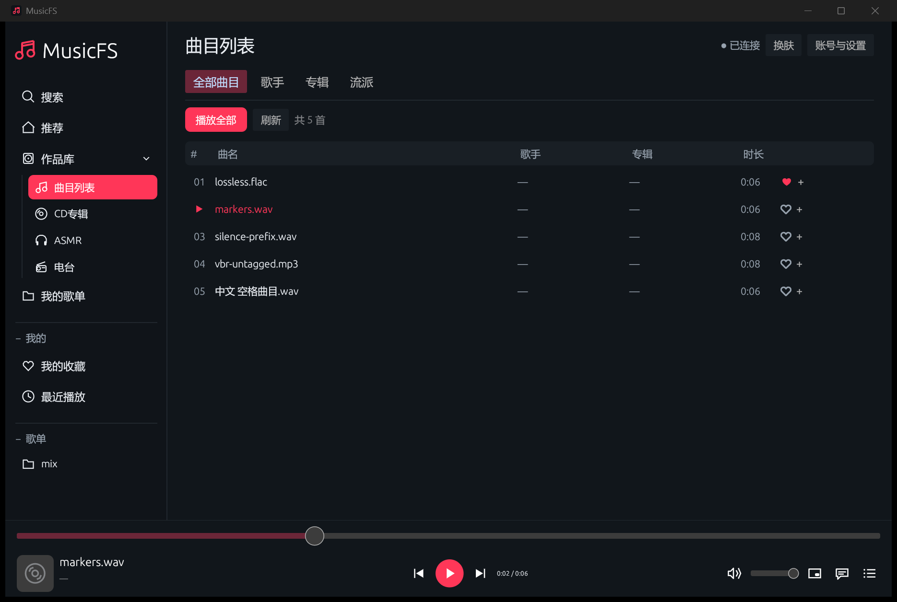

# MusicFS 桌面客户端

简体中文 · [English](docs/README.en.md)

MusicFS 桌面播放器连接已有的 MusicFS Server。窗口、界面、服务端连接和音频播放均使用 Rust。egui/eframe 绘制原生窗口，界面沿用 Web 的侧栏、曲库和底部播放栏。当前开发版本为 [0.1.0](VERSION)。



## 使用

1. 启动 MusicFS Server，在服务端添加音乐目录并完成扫描。
2. 打开 MusicFS 桌面端，在[登录窗口](docs/screenshots/windows-login.png)输入服务端地址和管理员登录令牌。本机默认地址为 `http://127.0.0.1:8080`，远程连接使用 HTTPS。
3. 从曲目列表、搜索、收藏或歌单选择歌曲。双击曲目开始播放，底部播放栏可切歌、调节音量和打开队列。支持定位的音频可拖动进度条。
4. 在界面中切换主题，在底部播放栏打开迷你播放器或桌面歌词。歌词取自服务端为当前音源选定的内容。关闭辅助窗口后继续播放，关闭主窗口退出应用。

在作品库中按服务端启用的类型浏览 CD 专辑、ASMR 和电台，查看作品资料及音轨。推荐页按来源展示歌单。曲目行右侧可收藏或加入歌单，修改歌单后在详情页更新内容即可播放。

会话保存在进程内，退出后需要重新登录。客户端保存上次连接的地址和主题。在「账号与设置」的「播放」中可分别开关进度跳转和切歌的淡出淡入。两项默认开启，重启后保留选择。播放器声明 MP3、FLAC 和 WAV，字节范围流支持定位，顺序流支持连续播放。当前环境与实测项目见[桌面验证记录](docs/validation/desktop.md)。

## 从源码运行

安装 Rust（rustup 将读取 [rust-toolchain.toml](rust-toolchain.toml)）。Windows 构建使用 Visual Studio 的 MSVC 工具链和 Windows SDK。Linux 需要系统窗口、图形和音频开发库，包括 X11/Wayland、OpenGL、ALSA、pkg-config；中文界面需要系统安装 CJK 字体，例如 Noto Sans CJK。

```sh
cargo run --locked --release -p musicfs-desktop
```

在本仓库根目录执行 `cargo build --locked --release -p musicfs-desktop` 生成可执行文件，运行 `cargo test --locked --workspace` 执行测试。在 Windows x64 安装 NSIS 后可运行 `./scripts/package-windows.ps1` 生成当前用户安装包。构建产物位于 `target/release/`。安装包自带所需的 Visual C++ 运行库。直接运行独立的 `musicfs-desktop.exe` 时，系统需要已有 x64 Visual C++ 运行库。

## 设计文档

- [桌面架构](docs/architecture.md)与[实现方案](docs/implementation.md)说明界面、原生播放器与本地 Server 的职责。原生插件宿主、本机 DSP、托管 Server 启动和系统媒体键属于后续实施范围。
- [连接 MusicFS Server](docs/implementation/server-integration.md)说明登录、播放协商和音频流读取。
- [音频处理](docs/audio-processing.md)与[插件宿主](docs/plugin-capabilities.md)说明解码、音效和设备输出的扩展方式。
- [跨平台验证计划](docs/implementation/platforms-validation.md)列出各系统的打包与设备验证项目。

本项目几乎完全由 AI 生成。项目采用 [GNU GPL v3](LICENSE) 许可证。其他客户端见 [MusicFS 主仓库](https://github.com/fnMrRice/MusicFS)。
