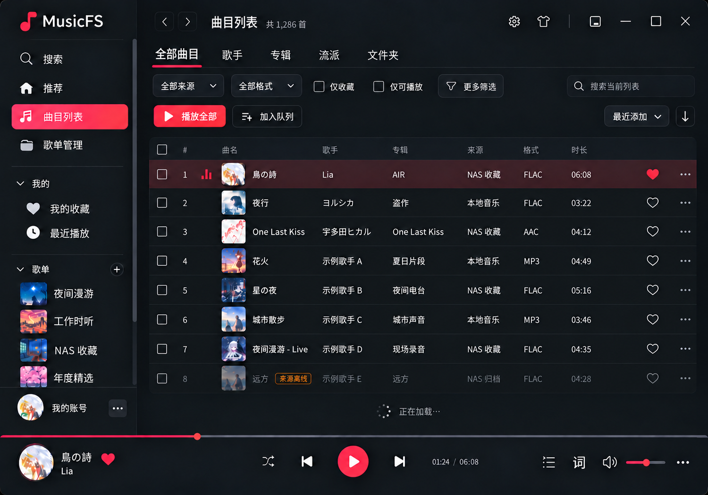

# MusicFS 桌面客户端

简体中文 · [English](docs/README.en.md)

MusicFS 桌面播放器面向 Windows、macOS 和 Linux。当前仓库提供架构设计与界面原型，尚无可运行版本。计划使用 React 和 Tauri 2 构建桌面界面，由 Rust 核心管理播放队列、音频输出和桌面歌词。

## 界面设计稿

图中展示计划中的曲目列表。歌单合并与音源选择的交互见[歌单线框](docs/prototypes/client.salt.puml)。

## 设计文档

- [桌面架构](docs/architecture.md)与[实现方案](docs/implementation.md)说明界面、原生播放器与本地 Server 的职责。
- [连接 MusicFS Server](docs/implementation/server-integration.md)说明登录、播放协商和音频流读取。
- [音频处理](docs/audio-processing.md)与[插件宿主](docs/plugin-capabilities.md)说明解码、音效和设备输出的扩展方式。
- [跨平台验证计划](docs/implementation/platforms-validation.md)列出各系统的打包与设备验证项目。

本项目几乎完全由 AI 生成。项目采用 [GNU GPL v3](LICENSE) 许可证。其他客户端见 [MusicFS 主仓库](https://github.com/fnMrRice/MusicFS)。
