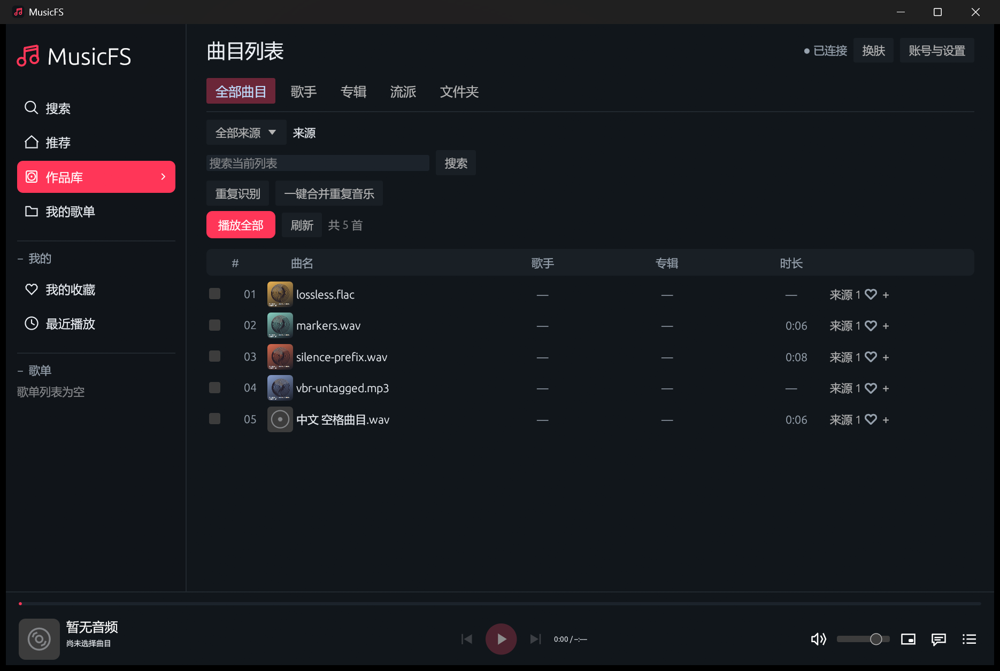

# MusicFS Desktop

[简体中文](../README.md) · English

MusicFS Desktop connects to a running MusicFS Server. The interface, server connection and audio player are written in Rust. Eframe and egui draw the native windows, with navigation and playback controls based on the Web design.



## Getting started

1. Start an existing MusicFS Server. Open the desktop app and sign in with the server URL and the token supplied by your administrator. The local default is `http://127.0.0.1:8080`. Use HTTPS for remote servers. Select **Stay signed in on this device** to store the credential in the operating system's credential store and reconnect to the same server on restart. Signing out removes the saved login. [Sign-in window](screenshots/windows-remember-login.png)
2. If your library is empty, an administrator can open **Settings → Music sources**, add a directory from the server's allowed locations and follow the scan. When connected remotely, the directory picker shows paths on the server.
3. Open the track list, select a source filter or browse artists, albums, genres and folders. Double-click a track to play. The bottom bar includes the queue, mini player and desktop lyrics. Drag the progress indicator to seek on supported byte-range streams.

## Library and settings

- A song can have multiple source recordings. You can audition a version, set a preferred source or pin a favorite or playlist entry to one version. An unpinned entry follows the default source. Playing a file in the folder browser uses that file's source.
- Review duplicate recording candidates, link or exclude sources, or apply a bulk matching rule. When merging tracks within an album, choose a primary track and resolve titles, aliases, artist credits, genre, year, rating and cover individually.
- Browse the work types enabled by the server, including CD albums, ASMR and radio. Open a work to see its files and tracks. The recommendations page groups playlists by source and offers refresh and history where supported. Add songs to a playlist and publish a snapshot from its detail page.
- Administrators can configure import rules, directory watching, album scraper priority and server plugins. Online providers can offer QR sign-in or anonymous lookup. For Apple Music, the app opens MusicFS Web on the same server in your system browser. Sign in there with the same MusicFS account to authorize MusicKit.
- The player decodes MP3, FLAC and WAV. Playback settings include automatic volume leveling, separate fade durations for track changes, pausing and seeking, and a request to transcode the next playback on the server. The local effects chain supports gain, a ten-band EQ, parametric EQ, compression and reverb. Output layouts depend on the default device's channel capacity. [Playback settings](screenshots/windows-playback-settings.png)
- The app offers built-in themes and can follow the system language or use English, Simplified Chinese, Traditional Chinese or Japanese. Lyrics follow the currently playing source. You can close either auxiliary window while playback continues.

## Build and run

From the repository root, use the [pinned Rust toolchain](../rust-toolchain.toml).

```sh
cargo run --locked --release -p musicfs-desktop
cargo test --locked --workspace
```

Windows builds require MSVC and the Windows SDK. On Windows x64, run `./scripts/package-windows.ps1` with NSIS installed to create the per-user installer under `target/release/`. The installer includes the required Visual C++ runtime. Running the standalone executable requires the x64 Visual C++ runtime on the system.

Linux builds require the system windowing, OpenGL, ALSA and D-Bus development libraries and pkg-config. Install a CJK font to display East Asian text. Remembering a login requires a working Secret Service.

## Design documents

- The [desktop validation record](validation/desktop.md) lists Windows x64 device and window checks, isolated server tests and outstanding platform checks.
- [Desktop architecture](architecture.md) and the [implementation plan](implementation.md) cover the client and player. An installable client plugin host, managed server startup and system media keys are planned.
- [Server integration](implementation/server-integration.md) covers sign-in, playback negotiation, and audio streaming.
- [Audio processing](audio-processing.md) and the [plugin host](plugin-capabilities.md) describe extensions for decoding, effects, and device output.
- The [cross-platform validation plan](implementation/platforms-validation.md) covers packaging and device testing on each operating system.

This project was generated almost entirely by AI and is licensed under the [GNU GPL v3](../LICENSE). See the [MusicFS project](https://github.com/fnMrRice/MusicFS) for other clients.
